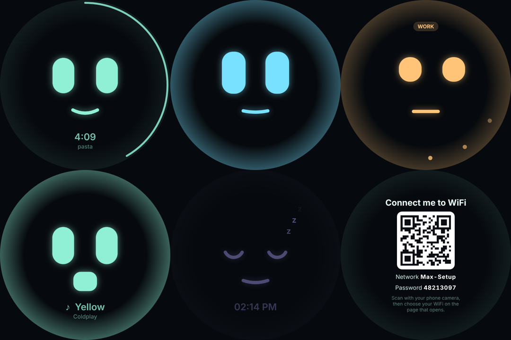

# Setting up the Max box (Raspberry Pi 5)

From a blank SD card to Max's face on the screen: about 45 minutes, most of it waiting.

## 1. Prepare the SD card (on your Mac)

1. Install **Raspberry Pi Imager** from <https://www.raspberrypi.com/software/> and insert the SD card.
2. Choose:
   - **Device:** Raspberry Pi 5
   - **Operating system:** Raspberry Pi OS (other) → **Raspberry Pi OS Lite (64-bit)**. Max draws his own
     screen, so the desktop version isn't needed.
   - **Storage:** your SD card
3. When asked to **apply OS customisation settings**, choose **Edit settings** and fill in:
   - **Hostname:** `max`
   - **Username and password:** your choice (remember them)
   - **Wireless LAN:** your WiFi name and password, **country GB**. This is how the box joins your WiFi
     the first time.
   - **Locale:** time zone Europe/London, keyboard gb
   - **Services** tab: **Enable SSH** with password authentication
4. Write the card, put it in the Pi, and connect the power. Wait about 3 minutes for the first start.

## 2. Connect to the box from your Mac

```bash
ssh YOUR-USERNAME@max.local
```

(Type `yes` the first time, then your password.) If `max.local` isn't found, wait a minute and try
again, or look up the Pi's address in your router's device list.

## 3. Copy Max onto the box

On your **Mac**, from the folder that contains `max-assistant`:

```bash
rsync -a --exclude node_modules --exclude dist --exclude data max-assistant YOUR-USERNAME@max.local:~/
```

This includes your `.env` (keys and settings). Then, on the **box** (over SSH), check these settings in
`~/max-assistant/.env` with `nano ~/max-assistant/.env`:

| Setting | On the box |
| --- | --- |
| `PULSE_SERVER` | **Delete this line** if it's there (it's for the Mac sound bridge) |
| `PANEL_PASSWORD` | Set one: the control panel will be reachable from your home network |
| `REALTIME_BARGE_IN=on` | Recommended: the mic board's echo cancellation lets you talk over Max |
| `COMPOSE_PROFILES=max,music` | Add `,music` if you use the Spotify speaker |
| `MEMORY_KEY` | Keep the same value as on your Mac |

## 4. Run the setup

On the box:

```bash
cd ~/max-assistant
sudo ./scripts/pi/setup.sh
```

It asks which screen is fitted (round DSI, round HDMI or none), installs everything, then builds and
starts Max. The first build takes 10–15 minutes on a Pi 5. When it finishes:

```bash
sudo reboot
```

After the restart, Max's face appears on the screen and he's listening for "Hey Max".

## Using the box

- **Control panel:** <http://max.local:8099> from any phone or computer on your WiFi.
- **Changing WiFi:** if the box can't reach a known WiFi network for a minute, or you **hold the screen
  for 5 seconds**, Max says so and shows a QR code. Scan it with your phone: it joins Max's temporary
  "Max-Setup" network and opens a page where you choose your WiFi and type its password. Max tells you
  when he's connected. If nobody uses the setup network for 10 minutes, it switches itself off and the
  box tries your known networks again.
- **The face:**

  

  It's asleep at night (23:00–07:00, `FACE_SLEEP` in `.env`), shows the time, timers counting
  down around the edge, what's playing, and a WORK or GUEST badge in those modes.
- **Preview on your Mac:** with Max running in Docker on the Mac, open <http://localhost:8098/?demo> to
  see every expression.

## Updating

Copy the new version from your Mac with the same `rsync` command, then on the box:

```bash
cd ~/max-assistant && sudo ./scripts/pi/setup.sh
```

## Troubleshooting

| Problem | What to do |
| --- | --- |
| Screen stays black | Check the ribbon cable. Then open `/boot/firmware/config.txt` and look at the line under `# max-box screen`. Waveshare's wiki for the 4inch DSI LCD (C) gives the exact line for your Pi; on a Pi 5 it may need `,dsi0` or `,dsi1` added, depending on which connector the cable is in. Reboot after changing it. |
| Face shows "Reconnecting…" | Max isn't running: `cd ~/max-assistant && docker compose logs --tail 50 max` |
| No sound, or Max can't hear | `pactl list short sinks` and `pactl list short sources` should list the mic board (XVF3800). If not, check its USB cable, then run `systemctl --user restart max-audio-defaults`. |
| Max doesn't wake reliably | Run `./scripts/wake-coach.sh` from where you usually sit: it measures how well he recognises you and tells you what to change. |
| Face service | `journalctl -u max-face -n 50` |
| WiFi setup service | `journalctl -u max-wifi -n 50` |
| Start WiFi setup without the screen | `echo 1 \| sudo tee /run/max/wifi-request` |

## What was and wasn't tested

The face screen, the WiFi setup page and its logic (offline detection, wrong password, hidden networks,
long-press) were tested on a development machine with a simulated network manager. The setup script was
checked for errors but has not yet been run on a real Pi 5 with these parts: the screen's driver line,
the kiosk start-up and the mic board's sound names are the parts to watch on the first run. Send the
output if anything goes wrong.
