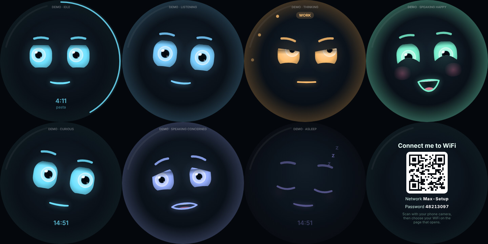

# Setting up the Max box (Raspberry Pi 5)

From a blank SD card to Max's face on the screen: about 45 minutes, most of it waiting.

## 1. Prepare the SD card (on your Mac)

1. Install **Raspberry Pi Imager** from <https://www.raspberrypi.com/software/> and insert the SD card.
2. Choose:
   - **Device:** Raspberry Pi 5
   - **Operating system:** Raspberry Pi OS (other) → **Raspberry Pi OS Lite (64-bit)**. Max draws his own
     screen, so the desktop version isn't needed.
   - **Storage:** your SD card
3. When asked to **apply OS customisation settings**, choose **Edit settings** and fill in:
   - **Hostname:** `max`
   - **Username and password:** your choice (remember them)
   - **Wireless LAN:** your WiFi name and password, **country GB**. This is how the box joins your WiFi
     the first time.
   - **Locale:** time zone Europe/London, keyboard gb
   - **Services** tab: **Enable SSH** with password authentication
4. Write the card, put it in the Pi, and connect the power. Wait about 3 minutes for the first start.

## 2. Connect to the box from your Mac

```bash
ssh YOUR-USERNAME@max.local
```

(Type `yes` the first time, then your password.) If `max.local` isn't found, wait a minute and try
again, or look up the Pi's address in your router's device list.

## 3. Copy Max onto the box

On your **Mac**, from the folder that contains `max-assistant`:

```bash
rsync -a --exclude node_modules --exclude dist --exclude data max-assistant YOUR-USERNAME@max.local:~/
```

This includes your `.env` (keys and settings). Then, on the **box** (over SSH), check these settings in
`~/max-assistant/.env` with `nano ~/max-assistant/.env`:

| Setting | On the box |
| --- | --- |
| `PULSE_SERVER` | **Delete this line** if it's there (it's for the Mac sound bridge) |
| `PANEL_PASSWORD` | Set one: the control panel will be reachable from your home network |
| `REALTIME_BARGE_IN=on` | Recommended: the mic board's echo cancellation lets you talk over Max |
| `COMPOSE_PROFILES=max,music` | Add `,music` if you use the Spotify speaker |
| `MEMORY_KEY` | Keep the same value as on your Mac |

## 4. Run the setup

On the box:

```bash
cd ~/max-assistant
sudo ./scripts/pi/setup.sh
```

It asks which screen is fitted (round DSI, round HDMI or none), installs everything, then builds and
starts Max. The first build takes 10–15 minutes on a Pi 5. When it finishes:

```bash
sudo reboot
```

After the restart, Max's face appears on the screen and he's listening for "Hey Max".

## Using the box

- **Control panel:** <http://max.local:8099> from any phone or computer on your WiFi.
- **Boot screen:** while the box starts (and shuts down) it shows Max's face on a dark screen instead of
  raspberries and scrolling text. To use **your own logo**:
  1. Make a **PNG** picture, ideally square, about **400 × 400 pixels**, with the important part inside a
     circle (the screen is round) and a transparent or dark background.
  2. Name it **`boot-logo.png`** and put it in the `max-assistant` folder on your Mac (next to `README.md`).
  3. Send Max to the box as usual (the `rsync` command) and run `sudo ./scripts/pi/setup.sh` on the box,
     then `sudo reboot`.

  To go back to Max's face, delete `boot-logo.png` from the folder on the Mac **and** on the box
  (`rm ~/max-assistant/boot-logo.png`), then run the setup again. `MAX_BOOT_LOGO=off sudo ./scripts/pi/setup.sh`
  leaves the boot screen alone.
- **Cards on the screen:** when there's something worth seeing, Max shrinks to a small face at the top and
  a card fills the screen; tap **Back to Max** (or wait) to return.
  - **Timer done / reminder:** with **OK** / **Again**, or **Done** / **Snooze 10 min**.
  - **Music:** cover, title, a progress bar and ⏮ ⏯ ⏭ buttons, when a song starts, or **tap the face** while
    music plays.
  - **Answers worth seeing:** when something is easier to see than hear (a list, a comparison, a forecast,
    an address), Max puts it on screen as well as saying it. Ask for a **recipe** or other instructions
    ("how do I make...", "how to...", "step by step", "show me...") and they always go on screen: the
    ingredients first, then one step at a time. Tap **Start** / **Next** / **Back**, or say "next step",
    "go back" or "step 4". If the AI ever only talks, Max builds the steps from what he said and shows them
    anyway.
  - **News:** while Max reads your briefing, the headlines and their sources are on screen.
  - **Email:** when Max reads your email, it's on screen: one email shows who it's from, when, the subject and
    a short summary of what it says (or the start of the text); several show as a list.
- **Notifications:** a card when something needs you, even if you didn't ask:
  - **News briefing ready**, with a **Headlines** button.
  - **Important email** (marked important in Gmail, or high importance in Outlook), checked every 10 minutes
    from 07:00 to 22:00 in the current mode's email. **Read it** reads out who it's from, the subject and the
    first lines.
  - **Overdue to-do**, once a day each (from 08:00), with **Done** and **Tomorrow** buttons (several at once: a
    list with **Done** on each).

  They wait for a good moment: never while you're talking to Max, never over a card you're using (a recipe, a
  timer), never during his sleep hours, and never in guest mode. Each can be switched off in
  **Settings → Screen** on the control panel.
  - **"What's going on in my day?"**: your reminders and to-dos (overdue and critical ones marked), with your
    calendar's events added as soon as Max reads the calendar. Asking about the calendar shows its events too.
  - **Captions** (off unless you switch them on in **Settings → Screen** on the control panel): what Max
    heard you say and what he's saying, under the face.
- **Glance (while Max is idle):** the weather at the top (for the home location set on the control panel,
  from Open-Meteo: free, no key), and under the clock your next meeting and a line like "2 critical ·
  1 overdue". **Tap the face** for "Your day" (meetings, reminders, to-dos and the weather); each to-do
  has a **Done** button (a ticked one stays struck through, with **Undo**). The next
  meeting comes from the current mode's calendar app, checked quietly every 20 minutes between 06:00 and
  23:00. In **guest mode** only the time and weather show, and a tap shows the weather for the next hours.
- **Evening photo frame:** upload pictures on the control panel (**Settings → Screen**; JPEG, PNG or WebP,
  kept on the box only) and switch it on. During the hours you choose (19:00–23:00 by default), after two
  quiet minutes, your pictures fade one into the next with the clock on top. "Hey Max" or a touch brings
  his face back. The glance can be switched off there too.
- **Volume and brightness:** hold a finger on the screen for 2 seconds: the menu has **Volume** and
  **Brightness** with − and + buttons. Or say "Max, louder", "volume to 30%", "dim the screen", or use
  **Settings → Device** on the control panel. Brightness is remembered when Max restarts.
- **Start-up code:** in **Settings → Security** on the control panel, set a 6-digit code. From then on, every
  time the box starts, Max shows a keypad and stays locked until the code is typed: he won't answer
  ("I'm locked, please enter my code on the screen"), won't run any action, and his screen shows nothing
  personal (no meetings, to-dos, emails, notifications or reminders; reminders that come due are said once
  he's unlocked). Max restarting on his own (an update) doesn't lock him again; turning the box off and on
  does. To lock him yourself, hold a finger on the screen for 2 seconds and tap **Lock**.
  - After 5 wrong tries the keypad pauses for 30 seconds, then 1, 2, 4... up to 15 minutes. Turning the box
    off and on doesn't reset this, and the control panel's "current code" boxes count towards the same tries.
  - Changing or turning off the code needs the current code. **Forgot it?** If the control panel has a
    password (`PANEL_PASSWORD`), sign in and use **Remove code**; otherwise delete `data/startup-code.json`
    in the `max-assistant` folder on the box and restart Max.
  - Only a scrambled fingerprint of the code is stored, never the code itself.
- **Turning off and on:** never just pull the plug (it can damage the SD card). Instead:
  - **Hold a finger on the screen for 2 seconds** for the menu: **Turn off**, **Restart**, **WiFi setup**
    (and volume and brightness).
    After choosing, you have 5 seconds to cancel. When the screen goes dark it's safe to unplug.
  - Or say **"Max, turn off"** / **"Max, restart"** (he asks you to confirm), or use **Settings → Device**
    on the control panel.
  - Or press the **power button on the Raspberry Pi** once.
  - **To turn it on again:** press the Pi's power button (or unplug and plug the power back in).
- **Changing WiFi:** if the box can't reach a known WiFi network for a minute, or you choose **WiFi
  setup** in the screen's menu, Max says so and shows a QR code. Scan it with your phone: it joins Max's temporary
  "Max-Setup" network and opens a page where you choose your WiFi and type its password. Max tells you
  when he's connected. If nobody uses the setup network for 10 minutes, it switches itself off and the
  box tries your known networks again.
  To leave setup mode (e.g. you opened it by mistake), tap **Back to Max** under the QR code: the box goes
  back to your usual WiFi straight away. Every screen in the menu has a **Back to Max** button.
- **The face:**

  

  - **Lip-sync:** his voice is analysed 20 times a second for its sound shape, so the mouth makes
    an open "a", a wide "ee", a round "oo", shows teeth on "s" and closes on "m".
  - **Expressions follow what he says:** apologies and problems look concerned, good news looks
    happy, questions look curious, "let me check" looks focused, timers and reminders look
    surprised. The expression relaxes back to neutral a few seconds after he finishes.
  - **Natural movement:** blinking, quick glances, breathing, a head tilt when he listens, and eyes
    that look up and away while he thinks.
  - It's asleep at night (23:00–07:00, `FACE_SLEEP` in `.env`), shows the time, timers counting
    down around the edge, what's playing, and a WORK or GUEST badge in those modes.
- **Preview on your Mac:** with Max running in Docker on the Mac, open <http://localhost:8098/?demo> to
  see every expression. To hold one, use its name, e.g. `?demo=happy`, `?demo=speaking-concerned`
  or `?demo=asleep`.

## Trying the face on your Mac (before the box arrives)

With Max running in Docker on your Mac (`docker compose --profile max up -d --build`):

1. Open <http://localhost:8098> in a browser and make the window square-ish.
2. Say "Hey Max" and ask something. The face listens, thinks, and its mouth moves with his voice.
   Try "what's the weather?" then something he can't do: his expression changes with the answer.
3. Or test without the microphone: type to Max with voice output, keeping the face in the browser:
   ```bash
   docker compose stop max
   docker compose run --rm --service-ports max node dist/tools/chat.js --speak
   ```
   (Afterwards: `docker compose --profile max up -d`.)
4. If the mouth moves a little **before** you hear the words, set `FACE_AUDIO_DELAY_MS=200` in `.env`
   (try 150–300) and restart Max. The Mac sound bridge buffers audio; the box usually needs less or none.

## Updating

Once the setup has run on the box, updates come **straight from GitHub**: no Mac, no `rsync`, no SSH.

- **On the box's screen:** hold it for 2 seconds and tap **Update**: it shows what's new and offers
  **Update now**.
- **Control panel → Settings → Updates** shows the installed version and, when there's a newer one, the list
  of what's new (the titles of the changes merged on GitHub). Press **Update now**.
- Or say **"Max, are there any updates?"** and **"Max, update yourself"** (he asks you to confirm).
- Or tick **Install updates automatically** (default 03:30): if there's something new, the box updates itself
  at night.

The box downloads the new version, runs the setup with the answers you gave the first time (kept in
`/etc/max/box.conf`), rebuilds Max and, only if a start-up setting changed, restarts. It takes 5 to 15
minutes; the face says "Updating…" and the control panel comes back by itself. Your `.env`, Max's memory,
your `boot-logo.png` and anything else that isn't part of the code stay as they are. If something goes
wrong, the box stays on the version it had, and the control panel says so (details in
`/var/log/max-update.log`).

By hand, on the box: `sudo python3 /usr/local/lib/max/max-update.py`.

The very first time (to install this updater) it's the old way: copy the new version from your Mac with the
`rsync` command, then run `cd ~/max-assistant && sudo ./scripts/pi/setup.sh`.

## Troubleshooting

| Problem | What to do |
| --- | --- |
| Screen stays black | On a Pi 5, use the cable with **one narrow end** (22-pin, into the Pi) and one wide end (15-pin, into the screen); the cable with two equal ends is for older Pis. Check both ends are fully in with the latches closed. Then run the setup again and make sure you picked the connector the cable is really in (`CAM/DISP 0` or `1`, printed on the Pi): `sudo MAX_DSI_PORT=0 ./scripts/pi/setup.sh` (or `=1`). |
| The desktop appears instead of Max's face | The card has Raspberry Pi OS **with desktop**. Run the setup again (it now switches the desktop off at boot), or by hand: `sudo systemctl disable lightdm && sudo systemctl enable max-face && sudo reboot`. To get the desktop back: `sudo systemctl enable lightdm && sudo reboot`. |
| Control panel won't open from the laptop | On the box, `docker compose ps` must show `0.0.0.0:8099->8099` for `max`; if it shows `127.0.0.1:8099`, run `docker compose -f docker-compose.yml -f docker-compose.pi.yml up -d` (the setup now makes this the default). On a Mac, if `curl http://<box address>:8099` works in Terminal but the browser doesn't, allow the browser in System Settings → Privacy & Security → Local Network. |
| A mouse pointer shows on the face | Run the setup again: it installs an invisible pointer for the face screen. If a mouse is plugged in, moving it over the face also hides the pointer. |
| Face shows "Reconnecting…" | Max isn't running: `cd ~/max-assistant && docker compose logs --tail 50 max` |
| No sound, or Max can't hear | `pactl list short sinks` and `pactl list short sources` should list the mic board (XVF3800). If not, check its USB cable, then run `systemctl --user restart max-audio-defaults`. |
| Max wakes up by himself (TV, music, noise) | Set `WAKEWORD_TRIGGER_LEVEL=2` in `.env` and run `docker compose -f docker-compose.yml -f docker-compose.pi.yml up -d`. The log line `Ignored a false wake-up` shows the double-check catching others. More: `training/README.md`, "Waking up by itself". |
| Max doesn't wake reliably | Run `./scripts/wake-coach.sh` from where you usually sit: it measures how well he recognises you and tells you what to change. |
| Face service | `journalctl -u max-face -n 50` |
| WiFi setup service | `journalctl -u max-wifi -n 50` |
| Start WiFi setup without the screen | `echo 1 \| sudo tee /run/max/wifi-request` |

## What was and wasn't tested

The face screen, the WiFi setup page and its logic (offline detection, wrong password, hidden networks,
long-press) were tested on a development machine with a simulated network manager. The setup script was
checked for errors but has not yet been run on a real Pi 5 with these parts: the screen's driver line,
the kiosk start-up and the mic board's sound names are the parts to watch on the first run. Send the
output if anything goes wrong.
