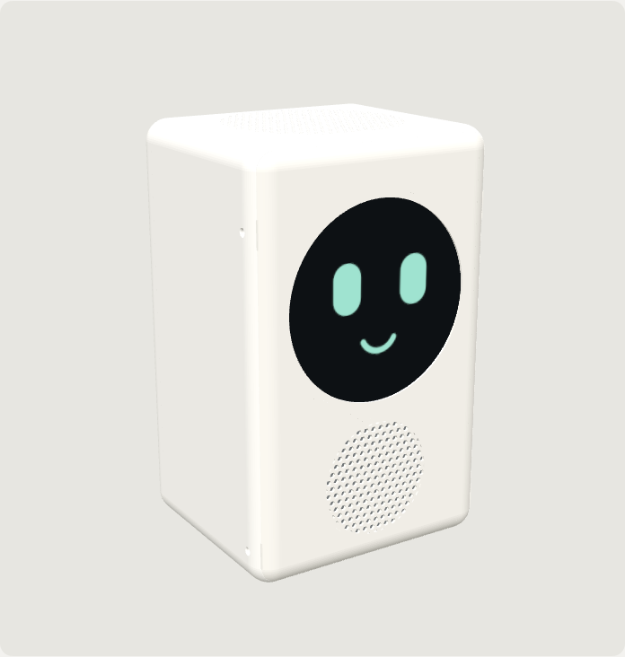
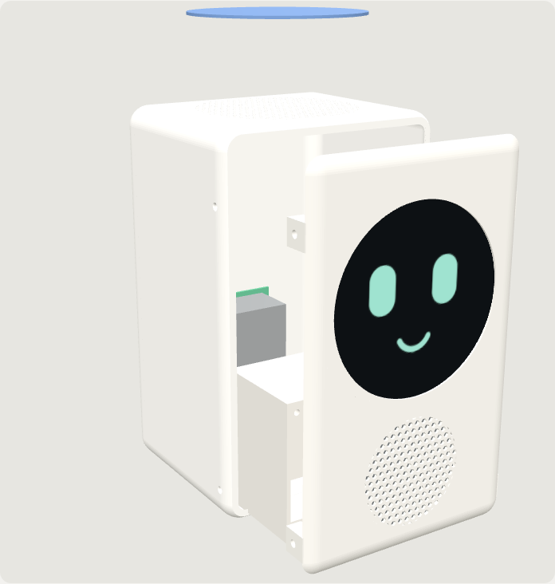
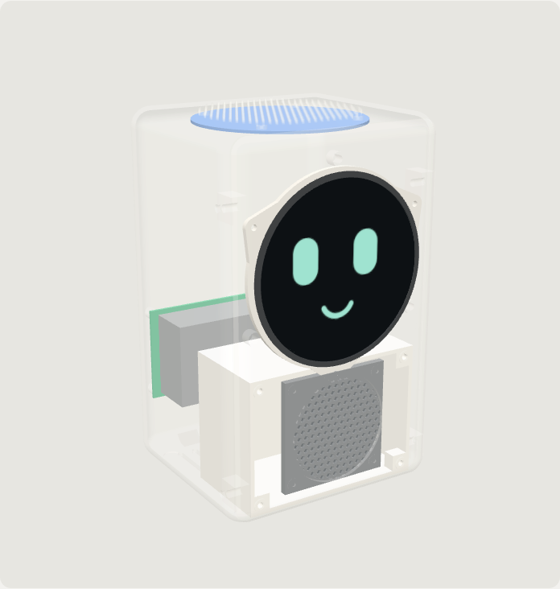

# Max box enclosure

A compact, 3D-printable home for Max: round 4″ face on the front, a sealed speaker below it, the
4-microphone array under a perforated top, and the Raspberry Pi 5 on the back wall.

**Outside size:** 142 mm wide × 120 mm deep × 226 mm tall.

| Assembled | Exploded | X-ray |
| --- | --- | --- |
|  |  |  |

An interactive 3D view is in `viewer/index.html` (serve the `viewer` folder and open it). Its `models/` files are the STLs encoded as text; regenerate them after re-exporting with `for p in body front chamber screen_ring; do base64 -w0 stl/$p.stl > viewer/models/$p.stl.b64.txt; done`.

## Parts it is designed for

| Part | Product |
| --- | --- |
| Computer | Raspberry Pi 5 (8 GB) + Active Cooler, running from an official Raspberry Pi A2 microSD card (64 GB). The Raspberry Pi SSD Kit (M.2 HAT+) can be added later: there is room for it. |
| Screen | Waveshare 4inch DSI LCD (C), round 720×720 |
| Microphones / sound | ReSpeaker XVF3800 USB 4-mic array (its built-in 5 W amplifier drives the speaker) |
| Speaker | Visaton FRS 7, 4 Ω (2.5″ full-range) |
| Power | Raspberry Pi 27 W USB-C power supply |

## Printed parts

| File | What it is | Print orientation |
| --- | --- | --- |
| `stl/body.stl` | Back, sides, top (mic grille) and bottom, open at the front | On its back, open side up |
| `stl/front.stl` | Front panel: screen window, speaker grille, mounting tabs | Face down |
| `stl/chamber.stl` | Sealed speaker box (≈0.44 L) that screws to the back of the front panel | Back wall down |
| `stl/screen_ring.stl` | Clamp ring that holds the screen in its recess | Flat |

PLA or PETG, 0.2 mm layers, 3 walls, 20% infill. No supports needed. A matte filament looks best;
print the front panel in a contrasting colour if you like a two-tone look.

## Hardware

- 12 × M3 heat-set inserts: 4 in the front-panel side tabs, 4 for the screen ring, 4 for the speaker
  chamber
- 8 × M3 × 8 mm screws (4 side screws for the front panel, 4 for the chamber) and 4 × M3 × 6 mm for the
  screen ring
- 12 × M2.5 × 6 mm self-tapping screws: 4 for the Pi, 4 for the mic board, 4 for the speaker (its
  bosses are pilot holes)
- Closed-cell EVA foam strip, single-sided adhesive, about 10 mm wide: **5 mm thick** for the ring
  between the mic board and the top (the gap is 4 mm, so it squashes and seals; keep the 4 mic holes
  clear), and **3 mm thick** for the speaker chamber gasket
- 4 × 10 mm rubber feet
- About 30 cm of speaker wire, a short right-angle USB-A to USB-C cable (mic board to Pi)

## Measure before printing

Some part sizes aren't published in a form I could check. Measure your parts with calipers (in mm) and
change the values marked `MEASURE` at the top of `max-box.scad`. Values marked `MEASURED` have been
taken from the real parts.

| Setting | How to measure | Value |
| --- | --- | --- |
| `screen_glass_d` | Screen face up: across the full glass, edge to edge, at a few angles; take the largest | **125.9 mm** (measured) |
| `screen_view_d` | Across the part that shows the picture, not the black border | **102.3 mm** (measured) |
| `screen_pcb` | Screen face down: the board behind the glass, long and short side, including the connector | **85.3 × 68.6 mm** (measured) |
| `screen_glass_t` | Calipers on the very edge of the glass, where it overhangs the board | **5.9 mm** (measured) |
| `screen_depth` | Screen face down: from the back of the glass to the highest point, including the ribbon socket | **16.8 mm** (measured) |
| `mic_board_d` | Across the mic board at its widest (say if it's square) | **100.2 mm** (measured) |
| `mic_stack` | Mic board plus the parts and speaker cable underneath it | **15.5 mm** (measured; board alone 7.8 mm) |
| `mic_post_r`, `mic_post_angles` | The board has 3 holes in a triangle (measured: 60.1, 60.1 and 40.7 mm apart). Still needed: each hole's distance to the nearest board edge, and which hole points towards the USB socket | 44 mm, 4 holes (placeholder) |
| `spk_hole_sq` | Centre-to-centre between two side-by-side speaker holes (tip: left edge of one hole to left edge of the other) | **49.3 mm** (measured) |
| `sd_z` | Pi held with the USB-C socket at the bottom: from that edge up to the middle of the microSD slot | 28 mm (estimate) |
| `pi_stack` | Pi with the fan fitted, flat on a table: from the underside of the board to the top of the fan | **19.7 mm** (measured); 30 mm allowed for the SSD kit |

Then re-export the parts (below). Printing just the front panel's screen area as a test ring first is
a cheap way to check the screen fit.

## Re-exporting the parts

Install [OpenSCAD](https://openscad.org), then from this folder:

```bash
for p in body front chamber screen_ring; do openscad -D "part=\"$p\"" -o stl/$p.stl max-box.scad; done
python3 stl2bin.py stl/*.stl      # optional: binary STL, about 5x smaller
```

`-D 'part="assembly"'` shows an exploded preview with stand-ins for the electronics. The body and
front panel take a few minutes each to compute because of the grille holes.

## Assembly

1. **Inserts:** press the heat-set inserts into the front panel's side tabs, the four screen-ring
   bosses and the four chamber bosses.
2. **Screen:** lay the screen face down into its recess in the front panel and fix the screen ring over
   it (4 × M3). Connect the ribbon cable to the screen first: on a Pi 5 use the
   one with one narrow and one wide end (wide end into the screen).
3. **Speaker:** screw the speaker to the back of the front panel behind the grille, connect the wire,
   then fix the chamber over it (4 × M3) with the foam gasket around its edge. Pass the wire through
   the hole in the chamber's back and seal the hole with hot glue: the box must be airtight to sound
   full.
4. **Pi:** fit the Active Cooler (and the SSD kit, if you have one) and insert the microSD card, then
   screw the Pi to the four posts on the back wall (USB-C power socket facing down). The card can later
   be swapped through the slot in the left side, using a fingernail or tweezers, without opening the box.
5. **Mic board:** stick the foam ring to the top of the board, then screw the board to the four posts
   under the top grille. Connect it to the Pi with the right-angle USB cable, and connect the speaker
   wire to the board's speaker socket.
6. **Close:** plug the screen ribbon's narrow end into the Pi's `CAM/DISP 1` connector
   (or `0`: the setup script asks which), slide the front panel in, and fix
   it with the four side screws. Route the USB-C power cable through the notch at the back.

## Design notes

- **Sound:** the speaker sits in its own sealed 0.44 L chamber. Sealed is what gives a small driver
  fuller, tighter sound; a driver loose inside a case sounds thin and boxy.
- **Microphones:** the mic board is foam-sealed to the perforated top and kept away from the speaker
  chamber, so the speaker's vibration and sound reach the mics as little as possible. The XVF3800's
  echo cancellation handles the rest, so "Hey Max" works while he talks or plays music.
- **Cooling:** air comes in through the slots in the base (rear half) and leaves through the slots in
  the back, past the Pi's cooler.
